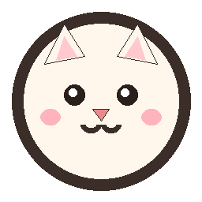

# Mochi - Windows 桌面宠物

一只用 Canvas 程序化绘制的奶白小猫，常驻桌面。基于 Electron。



## 功能

- **待机动画**：呼吸、眨眼、尾巴摆动、耳朵抖动、随机小动作（歪头/蹦跳/抖耳）
- **拖拽**：抓住宠物拖到任意位置，松手自动吸附任务栏（贴底 80px 内自动吸附）
- **点击互动**：点它有表情反应 + 气泡台词 + 爱心粒子，鼠标靠近眼球会跟随注视
- **气泡对话**：打字机效果气泡，各事件（番茄钟/训练/提醒/聊天回复）都会通过气泡播报
- **番茄钟**：专注/短休/长休循环，轮数可配，主进程计时（关面板不中断）
- **握力训练（两种模式）**：
  - **降压模式（等长握力 IHG，默认）**：按研究处方来——每侧持续握 2 分钟、左右手交替共 4 组、组间歇 90 秒、约三分力，**一周最多 3 次**（练满会拒绝开始并提示隔天再练）；剩余 10 秒时提醒「慢慢吐气，别憋气」，结束后提示测血压
  - **耐力循环**：原来的反复挤压节奏（握持/放松秒数 + 组数），参数独立保存
  - 宠物做持续轻握示范动画（抬起对应那只爪、慢慢加力、同步放慢呼吸），逐组倒计时，训练记录持久化
- **定时提醒**：每日定时提醒，列表管理
- **AI 聊天**：接 OpenAI 兼容接口，回复同步到宠物气泡；无 Key 时自动降级为内置语录
- **系统托盘**：显隐宠物、控制番茄钟、贴边、开机自启、退出
- **点击穿透**：宠物窗口透明区域不挡鼠标操作，只有宠物本体和气泡可交互

## 运行

```bash
npm install
npm start        # 普通启动
npm run dev      # 开发模式
npm test         # 摆放算法 + 握力节拍/配额 + 主进程 IPC 回归
npm run test:gui # 真起 Electron，用 CDP 验证面板与宠物渲染（会闪出窗口）
```

> 项目自带 `launcher.js`，会自动清除 `ELECTRON_RUN_AS_NODE` 环境变量——某些 CI/沙箱环境会注入该变量导致 Electron 退化成纯 Node。

## 打包成 exe

```bash
npm run dist     # 生成 NSIS 安装包到 release/
npm run pack     # 仅生成免安装目录
```

## 交互方式

| 操作 | 效果 |
|---|---|
| 左键点击宠物 | 开心反应 + 台词 + 粒子 |
| 左键按住拖动 | 移动宠物，松手落地/贴底 |
| 右键宠物 | 打开控制面板 |
| 托盘图标 | 全部菜单功能 |

## 配置

配置持久化在 `%APPDATA%/deskpet/config.json`，面板「设置」页可改：

- **宠物名字**、**宠物大小**（小=原来一半 / 偏小 / 标准 / 大，改完立即生效）、音效、开机自启
- **LLM**：API 地址 / Key / 模型 / 人设（任何 OpenAI 兼容接口均可）
- **番茄钟**：专注 / 短休 / 长休 / 轮数
- **握力训练**：模式切换、降压模式的持续秒数/间歇/组数/自觉用力（0-10，3 分≈三成力）、每周上限；耐力循环的握持/放松秒数与组数

## 降压模式的安全线

这一档是给高血压人群做辅助降压用的，几条硬性规则已写进界面提示：

- **全程不许憋气**（屏气用力会让血压瞬间猛蹿）；握的时候慢慢吐气，能正常说话说明力度合适
- **血压 ≥180/110、未控制的严重高血压、不稳定心绞痛、严重心衰**：先让医生评估，别自己练
- **一周最多 3 次、隔天练**；练得更快并不会降得更多
- **至少坚持 8 周**才看得到静息血压变化，停练会慢慢回落
- **不能替代降压药**，也别自行减药；服 β 受体阻滞剂/钙通道阻滞剂/血管扩张剂的人，结束后动作要慢并留意头晕
- 它是**有氧运动之外的补充**，不是地基

想更准确地按 30% 强度练，用一个电子握力计测一次最大握力，取三成当目标值，每 4 周复测上调。

## 项目结构

```
deskPet/
├── launcher.js          # 启动器（清环境变量后拉起 electron）
├── src/
│   ├── main.js          # 主进程：窗口/穿透/拖拽/托盘/IPC/LLM 中转
│   ├── preload.js       # contextBridge API
│   ├── store.js         # JSON 配置持久化
│   ├── timer.js         # 计时引擎（番茄钟/握力训练/提醒）
│   ├── placement.js     # 面板摆放算法（钳制进工作区）
│   ├── gripSchedule.js  # 降压握力的处方与每周配额规则
│   ├── pet/             # 宠物窗口（Canvas 绘制 + 状态机 + 气泡）
│   └── panel/           # 控制面板（番茄钟/训练/提醒/聊天/统计/设置）
├── test/                # 无依赖回归测试（npm test）
├── tools/e2e-grip.js    # Electron + CDP 的端到端冒烟（npm run test:gui）
└── assets/              # 托盘与应用图标
```
